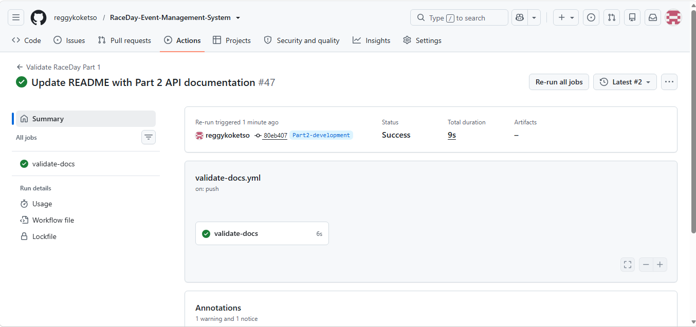

# RaceDay – Event Management System

[](https://github.com/reggykokotso/RaceDay-Event-Management-System/actions/workflows/dotnet.yml)

## Project Overview

RaceDay is a full-stack web-based event management system designed for the South African road running, walking and cycling community. The system aims to make it easier for event organisers to manage events, categories, participant enrolments and race results, while allowing participants to browse upcoming events, enter races and track their personal performance.

The system is being developed progressively across three parts. Part 1 focuses on system planning and database design before application code is written. This includes the Entity Relationship Diagram (ERD), API endpoint plan and SQL Server database script.

## System Roles

### Organiser

The Organiser is responsible for managing events on the RaceDay platform. An Organiser can:

* Create, edit and delete events.
* Create and manage event categories.
* View participant enrolments.
* Capture and manage participant results.
* Manage information required for race-day events.

### Participant

The Participant is a user who takes part in RaceDay events. A Participant can:

* Create an account and log in.
* Browse upcoming events.
* Select an event category and enrol in an event.
* View their own event enrolments.
* View and track their personal race results.

## Part 1 – System Planning and Database

Part 1 establishes the foundation of the RaceDay system before application development begins. The planning documents include:

* Entity Relationship Diagram (ERD)
* API Endpoint Plan
* SQL Server Database Script

The SQL database contains the entities required to support organisers, participants, events, categories, routes, enrolments and results. The database script also contains fictional sample data used to test and demonstrate the database.

## Repository Structure

```text
RaceDay/
├── docs/
│   ├── RaceDay-ERD.png
│   ├── RaceDay-Endpoint-Plan.md
│   ├── RaceDay.sql
│   └── Seed-Data-Note.md
│
├── .github/
│   └── workflows/
│       ├── validate-docs.yml
│       └── dotnet.yml
│
├── RaceDayAPI/
│   ├── Controllers/
│   ├── Data/
│   ├── Models/
│   ├── Migrations/
│   ├── Properties/
│   ├── appsettings.json
│   └── Program.cs
│
├── RaceDayAPI.Tests/
│   └── UnitTest1.cs
│
└── README.md
```

**## Part 1 Video Presentation**

The Part 1 video presentation demonstrates the RaceDay system planning, ERD, API Endpoint Plan, SQL Server database and GitHub Actions validation.

[Watch the Part 1 Video on YouTube](https://youtu.be/KbGUxsuErm0)


## Part 2 Demonstration Video

The demonstration video covers the RaceDay RESTful API, database integration, JWT authentication, role-based access control, automated testing, and GitHub Actions CI/CD.

**YouTube:** https://youtu.be/FPimfRnT3qo

## CI/CD

The GitHub Actions validation workflow was successfully executed to verify the required RaceDay documentation structure.

The successful workflow run is shown in the CI/CD evidence screenshot below.

!The successful Part 2 GitHub Actions workflow run is shown below.



## Database

The RaceDay system uses a relational SQL Server database to store and manage information required by the platform.

The database design includes users, events, categories, routes, enrolments and results. Primary keys are used to uniquely identify records, while foreign keys establish relationships between related entities.

The database script is located in the `/docs` folder and contains the table definitions, constraints and fictional sample data required for testing.

The SQL script was tested using SQL Server Management Studio (SSMS).

## Part 1 Requirements

The planning stage of the RaceDay project establishes the foundation for the later development of the system.

The main deliverables for Part 1 are:

- Entity Relationship Diagram (ERD) showing the database entities, attributes, keys and relationships.
- API Endpoint Plan covering authentication, user profiles, events, categories, enrolments and results.
- SQL Server database script containing the complete database schema, constraints and sample data.
- GitHub repository containing the required planning documents.
- GitHub Actions workflow to validate the required repository structure.
- Video presentation explaining the planning decisions and demonstrating the SQL database script in SSMS.

## Documentation

All Part 1 planning and database documents are stored in the `/docs` folder.

### ERD

The ERD provides a visual representation of the RaceDay database. It identifies the entities, attributes, primary keys, foreign keys and relationships required by the system.

### API Endpoint Plan

The API Endpoint Plan defines the RESTful endpoints that will be implemented in later parts of the project. It specifies the HTTP method, route, purpose, required role, request body and expected response for each endpoint.

### SQL Database Script

The SQL script creates and populates the RaceDay SQL Server database. It includes the database tables, primary keys, foreign keys, constraints and sample data required for testing.

These documents form the foundation for the API and MVC application that will be developed in Parts 2 and 3.

## Database Testing

The RaceDay SQL database script was tested using SQL Server Management Studio (SSMS).

The script was executed to create the database tables, relationships, constraints and sample records. Verification queries were also used to confirm that the sample organisers, participants, events, categories, enrolments and results were stored correctly.

The SQL script and supporting testing evidence are included in the `/docs` folder.

## Part 1 Progress

The main planning and database activities for Part 1 have been completed.

- [x] ERD created
- [x] API endpoint plan created
- [x] SQL Server database script created
- [x] Database sample data added
- [x] SQL script tested in SSMS
- [x] Project documentation added
- [x] GitHub Actions validation
- [x] CI/CD success screenshot
- [x] Part 1 video presentation
- [x] YouTube video link added to README


## GitHub Repository

The repository is organised so that the planning documents and supporting configuration files are kept in clearly defined locations.

The `/docs` folder contains the Part 1 planning and database documentation, while the `.github/workflows` folder contains the GitHub Actions workflow used to validate the required documentation structure.

This structure will be maintained as the project progresses through Parts 2 and 3.

## Part 2 – RESTful API

Part 2 implements the RaceDay RESTful API using ASP.NET Core Web API and .NET 8. The API connects to the SQL Server database using Entity Framework Core.

### API Features

- RESTful CRUD endpoints for users, events, categories, routes, enrolments and results.
- User registration and login using JWT authentication.
- Role-based access for Organisers and Participants.
- Swagger/OpenAPI documentation and API testing.
- Entity Framework Core with SQL Server.
- Unit tests using xUnit and the EF Core InMemory provider.
- GitHub Actions CI to automatically restore, build and test the API.

### Running the API

1. Open the RaceDay solution in Visual Studio.
2. Check that SQL Server LocalDB is installed and running.
3. Check the `RaceDayConnection` connection string in `appsettings.json`.
4. Open the Package Manager Console and run `Update-Database`.
5. Set `RaceDayAPI` as the startup project.
6. Run the project.
7. Open Swagger in your browser.
8. Use the authentication endpoints to register or log in, then test the API endpoints.

### Unit Testing

The `RaceDayAPI.Tests` project contains automated xUnit tests for the authentication and registration functionality.

The tests use the EF Core InMemory provider, allowing them to run without modifying the SQL Server database.

The current tests verify that participant registration succeeds with valid details and that duplicate email registration is rejected.

To run the tests, open a terminal at the repository root and execute:

`dotnet test RaceDayAPI.Tests/RaceDayAPI.Tests.csproj`

### Continuous Integration

GitHub Actions is used to automatically restore dependencies, build the RaceDay API and run the automated unit tests whenever changes are pushed to the repository.

### API Endpoints

The RaceDay API provides RESTful endpoints for managing the main resources of the system.

| Resource | Main Operations |
|---|---|
| Authentication | Register and login users |
| Users | Create, view, update and delete users |
| Events | Create, view, update and delete events |
| Categories | Create, view, update and delete event categories |
| Routes | Create, view, update and delete race routes |
| Enrolments | Create, view, update and delete participant enrolments |
| Results | Create, view, update and delete race results |

The API endpoints can be viewed and tested through the Swagger/OpenAPI interface when the application is running.


## Future Development

Part 2 has implemented the RaceDay RESTful API, authentication, database connectivity, automated unit tests and GitHub Actions continuous integration.

In Part 3, an MVC web application will consume the RESTful API and provide the user interface for Organisers and Participants. Additional functionality such as Azure Blob Storage and Docker containerisation will also be integrated.

The database design and RESTful API developed in Parts 1 and 2 will therefore provide the foundation for the final stage of the RaceDay system.